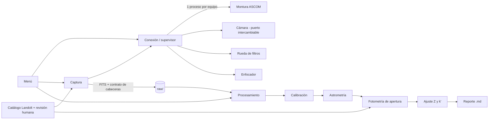

# OAG-PLAN-001 — Plan del proyecto: control del OAG y calibración fotométrica (v1)

> **Estado: BORRADOR para aprobación.** Hasta que este plan se apruebe **no se escribe código de control de hardware**.
> Convención: lo que figura como *PENDIENTE* **no está hecho ni confirmado**; el software lo trata como bloqueado, nunca como supuesto.

## 1. Objetivo y alcance de la versión 1

Medir el **punto cero Z** y el **coeficiente de extinción k′** por filtro (Johnson U, B, V, R, I) del sistema telescopio + Moravian G2-8300, mediante **fotometría de apertura** sobre campos estelares de Landolt, desde un único PC (OAG-PC-CTRL-01, Windows 11, Python).

**Incluye**
- Conexión y prueba **individual** de montura, cámara, rueda de filtros y enfocador.
- Captura: bias, darks, flats por filtro y secuencia de campo Landolt (N exposiciones por filtro, con masa de aire X registrada).
- Procesamiento: calibración, astrometría, fotometría de apertura (radio y anillo de cielo configurables), ajuste de Z y k′, reporte.
- Menú con dos bloques (Captura / Procesamiento) que **declara el nivel de automatización de cada opción**.

**Excluye de la v1**
- ASI071MC Pro, ASI224MC Pro, ASI183MC Pro.
- Guiado: la cámara ZWO ASI120MC-S y **PHD2 están en curso**; la v1 solo puede *anotar* si se guió o no, no controlarlo.
- Acceso remoto, domo y estación meteorológica (ver decisión D-06 en [[OAG-DEP-001 Dependencias pendientes]]).
- Cambio planeado a cámara planetaria CMOS: **no se implementa, pero el diseño lo debe permitir** (§6).

## 2. Qué está confirmado y qué no

| Dato | Estado | Fuente |
|---|---|---|
| PC OAG-PC-CTRL-01, Windows 11, Python | Confirmado | Usuario |
| Sitio 5°33′N, 73°21′W, 2750 m (≈ +5.550°, −73.350°) | Confirmado por el usuario; validar con coordenadas oficiales | Usuario |
| Montura Orion Atlas EQ-G, SynScan, COM6, driver «SkyWatcher Telescope» | Datos de configuración confirmados | Usuario |
| Cámara Moravian G2-8300, driver «Moravian USB Camera 1 (64 bit) ASCOM» | Datos de configuración confirmados | Usuario |
| Rueda Moravian 7 posiciones, driver «Moravian USB Filter Wheel 1 (64 bit)» | Datos de configuración confirmados | Usuario |
| Enfocador Gemini Astro Focuser Pro (CH340), COM7 | **Confirmado y funcional** | Usuario |
| Filtros Johnson U, B, V, R, I | Confirmados (5 filtros en 7 posiciones) | Usuario |
| **Orden físico de filtros en la rueda** | **PENDIENTE** | — |
| **Prueba de GoTo** | **PENDIENTE** | — |
| **Prueba de darks** | **PENDIENTE** | — |
| **Reductor óptico (reducer)** | **PENDIENTE** → escala de placa y campo de visión desconocidos | — |
| **Lista de campos Landolt** | **PENDIENTE** (no elegida; no se inventa) | — |

Los números COM pueden cambiar tras reiniciar o reconectar USB: se guardan en configuración y se **verifican en cada arranque**.

## 3. Principios de diseño

1. **Aislamiento de fallos.** Cada equipo vive en su propio módulo; un fallo (excepción, cuelgue de driver, desconexión USB) no debe tumbar a los demás ni al menú. Los drivers ASCOM son COM de 64 bits y pueden colgar la llamada: cada uno corre en un **proceso trabajador propio** con *heartbeat*, *timeout* y reinicio.
2. **Compuertas (*gates*) por pendiente.** Cada dato PENDIENTE es un campo de configuración con estado `pendiente | confirmado`. Las acciones que dependen de él se **rechazan con un mensaje claro** mientras esté pendiente (p. ej. no se capturan flats «por filtro» sin orden de filtros confirmado).
3. **El procesamiento solo lee archivos FITS.** Captura y procesamiento se comunican únicamente por un *contrato de cabeceras FITS* (§6). Así se puede reprocesar sin hardware y cambiar de cámara sin tocar el pipeline.
4. **Nada inventado.** Ni coordenadas ni magnitudes de Landolt en el código; vienen de un catálogo consultado y de un archivo que el usuario revisa y aprueba.
5. **Todo reproducible.** Cada sesión tiene un identificador `OAG-SES-AAAA-MM-DD-NN`; cada producto guarda la configuración y versiones usadas.
6. **Pruebas sin hardware** (simuladores) para la lógica; **pruebas con hardware** marcadas aparte y ejecutadas con el usuario presente.

## 4. Arquitectura y módulos



| Módulo | Responsabilidad | Entradas → salidas |
|---|---|---|
| `core` | Configuración validada, identificadores de sesión, registro (log), compuertas | YAML → objetos validados |
| `connection` | Estado de cada equipo (`DESCONECTADO → CONECTANDO → CONECTADO → FALLA`), supervisor, *watchdog*, prueba individual | config → estado por equipo |
| `devices` | Puertos (interfaces) montura/cámara/filtros/enfocador + adaptadores ASCOM + simuladores | — |
| `capture` | Bias, darks, flats, secuencia Landolt, masa de aire, cabeceras FITS | plan → FITS en `raw/` |
| `catalogs` | Consulta Landolt (VizieR/astroquery), filtro por declinación/altitud, archivo revisable | catálogo → `landolt_campos.yaml` |
| `processing` | Calibración (masters), astrometría (resolución WCS), correspondencia con estándares, fotometría de apertura | FITS → tablas de fotometría |
| `fitting` | Ajuste de Z y k′ por filtro, incertidumbres, residuos, *sigma-clipping* | tablas → parámetros + figuras |
| `report` | Informe en Markdown por sesión, listo para la bóveda | resultados → `.md` |
| `menu` | Registro de opciones con nivel de automatización y prerrequisitos; interfaz (consola y/o PySide6) | — |

Física y estadística del ajuste: ver [[OAG-FOT-001 Modelo fotométrico Z y k]]. Opciones del menú: [[OAG-MENU-001 Menú y automatización]].

## 5. Estructura de carpetas

**Código (repositorio `goranchacha-control/`)**

```
goranchacha-control/
├─ config/
│  ├─ equipo.yaml            # drivers (ProgID), puertos, timeouts; cada dato con estado pendiente|confirmado
│  ├─ filtros.yaml           # mapa posición→filtro (hoy: PENDIENTE), offsets de enfoque
│  ├─ sitio.yaml             # 5°33'N, 73°21'W, 2750 m
│  ├─ landolt_campos.yaml    # lista revisable (hoy: no existe)
│  ├─ fotometria.yaml        # radio de apertura, anillo de cielo, clipping, umbrales
│  └─ ajuste.yaml            # modelo (Z, k'; término de color opcional), criterios
├─ src/goranchacha/
│  ├─ core/        connection/   devices/{ports,ascom_com,sim}/
│  ├─ capture/     catalogs/     processing/   fitting/   report/   menu/
├─ tests/{unit,contract,sim,hardware}/   # hardware/: solo manual, con el usuario presente
└─ docs/obsidian/                        # estas notas
```

**Datos (una carpeta por sesión)**

```
datos/OAG-SES-AAAA-MM-DD-NN/
├─ session.md               # nota de sesión (plantilla en §9)
├─ raw/{bias,dark,flat,landolt}/
├─ masters/   calibrated/   astrometry/   photometry/   fit/   report/
└─ log/
```

**Bóveda Obsidian `OAG-UPTC`** (sugerido): `Proyectos/Calibración fotométrica/` con estas notas, y `Sesiones/OAG-SES-…` con una nota por sesión.

## 6. Capa de cámara intercambiable (Moravian → CMOS planetaria)

- **Puerto `CameraPort`** (interfaz mínima: conectar, exponer, abortar, enfriar, binning, ROI, leer imagen) y **`CameraCapabilities`** declaradas por cada adaptador: tamaño y píxel, profundidad de bits, ¿tiene enfriador?, ¿tiene obturador mecánico?, ¿es color (Bayer)?, ganancia/offset, rango de exposición.
- **Contrato de cabeceras FITS normalizado**, independiente de la cámara: `DATE-OBS` (inicio) y `EXPTIME`, `IMAGETYP`, `FILTER`, `OBJECT`, `XBINNING/YBINNING`, `CCD-TEMP`, `GAIN`, `OFFSET`, `EGAIN` (e⁻/ADU, si se conoce), `PIXSIZE1/2`, `BAYERPAT` (vacío si mono), `INSTRUME`, `SESSID` (= `OAG-SES-…`), `AIRMASS` y `OAGAIRM` (ver [[OAG-FOT-001 Modelo fotométrico Z y k]]), `RA/DEC` del puntero.
- **Pruebas de conformidad:** el mismo conjunto de pruebas se ejecuta contra el simulador y contra cada adaptador real; cambiar de cámara = escribir un adaptador que las pase, sin tocar `processing` ni `fitting`.
- **Riesgos conocidos del cambio** (a resolver antes de adoptar la CMOS, no ahora): si es **color (OSC)** hay que definir qué se mide (canal, desmosaico) y cómo se relaciona con filtros Johnson; las CMOS planetarias suelen **no tener obturador** (darks con tapa) y tener **rango dinámico y linealidad** distintos; las exposiciones cortas aumentan el efecto de centelleo.

## 7. Reutilización del v0.1 ya construido

El v0.1 de esta sesión (servidor FastAPI, GUI PySide6, simuladores, cliente Alpaca, FITS, autoenfoque, secuenciador) **se conserva como base**, con estos cambios previstos *tras la aprobación*:

| Pieza v0.1 | Decisión propuesta |
|---|---|
| Interfaces de dispositivos y simuladores | Reutilizar; separar en puertos + adaptadores; añadir adaptador **ASCOM por COM** (hoy solo hay Alpaca) |
| `fits_io`, `astro`, `autofocus`, `logbook` | Reutilizar y ajustar al contrato de cabeceras |
| Seguridad meteorológica, domo, cierre de emergencia | **Congelar** hasta decidir D-06 (el domo y la estación no figuran en el hardware de la v1) |
| Servidor/cliente remoto | **Congelar**; la v1 corre local en el PC |
| GUI | Reutilizar como contenedor del nuevo menú |
| Coordenadas del sitio | Ya corregidas a 5.55°N, −73.35°, 2750 m (antes eran valores aproximados erróneos) |

## 8. Fases (resumen; detalle y criterios en [[OAG-CHK-001 Checklist y criterios de aceptación]])

| Fase | Contenido | Necesita hardware |
|---|---|---|
| F0 | Aprobación del plan y decisiones abiertas | No |
| F1 | Fundaciones: config, sesiones, compuertas, marco de módulos aislados, registro del menú | No |
| F2 | Conexión y prueba **equipo por equipo** (montura → enfocador → rueda → cámara) | **Sí** |
| F3 | Captura de calibración (bias, darks, flats) | Sí |
| F4 | Catálogo Landolt + revisión de la lista + secuencia de campo con X | Sí (cielo) |
| F5 | Procesamiento: calibración, astrometría, fotometría de apertura | No (con datos reales o sintéticos) |
| F6 | Ajuste Z y k′ + reporte | No |
| F7 | Validación con una noche real y cierre documental | Sí (cielo) |

Orden de conexión propuesto en F2: **enfocador** (ya funcional) → **montura** (sin GoTo hasta decidir) → **rueda** → **cámara**; así se valida el marco con lo más sencillo primero.

## 9. Plantilla de nota de sesión (`session.md`)

```markdown
---
id: OAG-SES-AAAA-MM-DD-NN      # NN = consecutivo del día, empieza en 01
tipo: sesion
operador:
estado: planificada | en-curso | cerrada
---
## Condiciones (cielo, humedad, viento, luna)         <!-- lo anota el operador -->
## Equipos usados y estado (✓ probado / ✗ falla / pendiente)
## Mapa de filtros usado (confirmado: sí/no)
## Campos Landolt observados (id, filtros, N, X mín–máx)
## Guiado: sí / no (PHD2)
## Incidencias
## Productos (enlaces a calibración, fotometría, ajuste, reporte)
```

## 10. Riesgos principales

| Riesgo | Efecto | Mitigación |
|---|---|---|
| Orden de filtros incorrecto | Z y k′ asignados al filtro equivocado | Gate + verificación documentada antes de cualquier captura por filtro |
| Filtro U con KAF-8300 | Baja señal; k′ de U incierto | Evaluar exposiciones/SNR en F4; aceptar «U no calibrable» como resultado válido |
| Campo de visión pequeño (sin reducer) | Pocas estándares por campo | Elegir campos con la escala real; ver D-03 |
| Cuelgue de driver COM | Bloquea la aplicación | Proceso por equipo + *watchdog* |
| Noche no fotométrica | Ajuste inválido | Criterios de validez y rechazo en el ajuste (nunca reportar sin ellos) |
| Cambio de cámara | Reescribir pipeline | Puerto + contrato FITS + pruebas de conformidad |
| Cambio de COM tras reinicio | Equipo no encontrado | Verificación al arranque + elección por driver, no solo por puerto |

## 11. Para aprobar este plan necesito

1. Revisión de las decisiones abiertas D-01…D-11 en [[OAG-DEP-001 Dependencias pendientes]].
2. Confirmar el orden de fases F1→F7 y que la v1 corre **local** (sin servidor remoto).
3. Confirmar que se congela lo de domo/clima del v0.1 (D-06).
